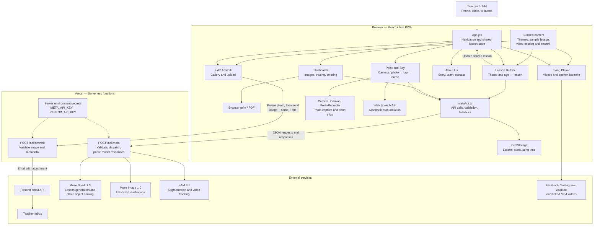
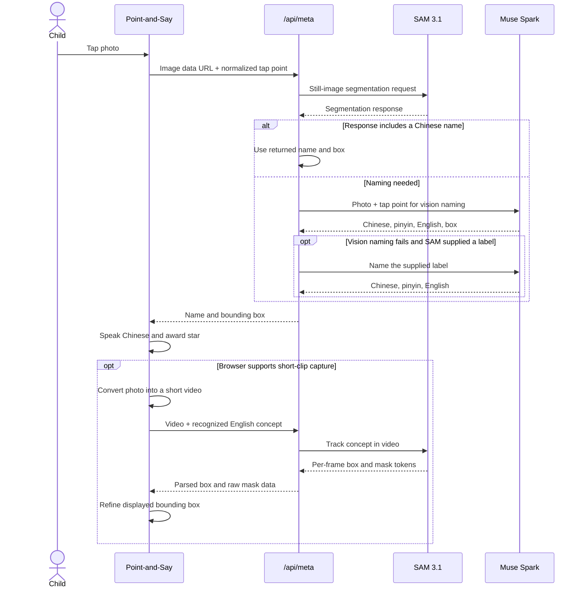

# Cozy Bear Cottage 小熊中文

**Live app:** https://cozybear-cottage.vercel.app
**Team:** Yukui McDonald (team lead), Patrick McDonald, Xiaoyue He, Shun Zhang
**Artwork:** Vivian McDonald (visual design) and Evelyn McDonald
**Contact:** applebearscabinet26@gmail.com
**Event:** Meta Global AI Developer Hackathon (Indie track) — submission due Nov 4, 2026, 9:00 PM ET

An AI co-teacher for weekend Chinese classes for children ages 3–6, grown out of
a real Saturday-morning class in Bear, Delaware. A teacher picks a theme; Cozy
Bear builds the lesson, makes the flashcards, and gives children pictures they
can tap to hear and repeat the Chinese words. The browser never holds the API
key — every model call goes through a serverless proxy — and every AI feature
has a working fallback, so the demo never dead-ends.

## The five tabs

1. **Lesson Builder 备课** — Muse Spark 1.3 generates a structured lesson
   (theme + age range in, strict lesson JSON out): words of the week, teaching
   script, songs and activities. A Sing-along player brings the Chinese
   Playtime song catalog into the lesson, with spoken karaoke.
2. **Living Flashcards 单词卡** — Muse Image 1.0 generates a card illustration
   for each word (Chinese / English), with an emoji fallback and a print pack
   for the classroom.
3. **Point-and-Say 指着说** — children tap objects in a picture and hear the
   Chinese name spoken aloud (Web Speech API, zh-CN), earning a star for each
   word. See the sequence diagram below for the full tap-to-name flow.
4. **About 关于我们** — what Cozy Bear is, the team, the Saturday class poster,
   and contact.
5. **Kids' Artwork 孩子们的画** — a gallery of Vivian's and Evelyn's original
   artworks (the same pictures children explore in Point-and-Say), photos of
   the young artists at work, and an upload section where other children can
   add their own artwork with a title and artist name; artwork can be emailed
   to the teacher through the app.

## Architecture



## Point-and-Say: tap-to-name sequence



**Implementation status (honest notes for reviewers):** the bundled sample
pack (26 pictures, 57 pre-mapped tap zones) serves Point-and-Say taps today,
so the feature works end-to-end in the live app; the SAM 3.1 segmentation
route in the proxy is the integration path for arbitrary uploaded photos and
video tracking, as diagrammed. Lesson generation, flashcard illustration,
and object naming run live against the Meta Model API through `/api/meta`,
each with a local fallback. Kids' artwork email runs through `/api/artwork`
and Resend to the teacher inbox (applebearscabinet26@gmail.com).

## Run it locally

```bash
npm install
cp .env.example .env.local   # META_API_KEY (server-side only); RESEND_API_KEY for artwork email
vercel dev                   # use vercel dev, not npm run dev, so /api functions run
```

Deploy: push to GitHub, import in Vercel, set the environment variables
(Production), deploy. The `/api/meta` and `/api/artwork` functions keep all
keys off the browser.

## Design

Vivian's artwork is the design language — her palette (light blue; no orange),
her cutouts as mascots, and the children's paintings as the Point-and-Say
world. Vivian and Evelyn are credited in the app shell and on the Kids'
Artwork page.

## Sister project

The same team also built **WalletShield** — an AI technology-control copilot
for digital currency wallets, from team lead Yukui McDonald's PhD research at
the University of Delaware: https://walletshield.yollin.me
